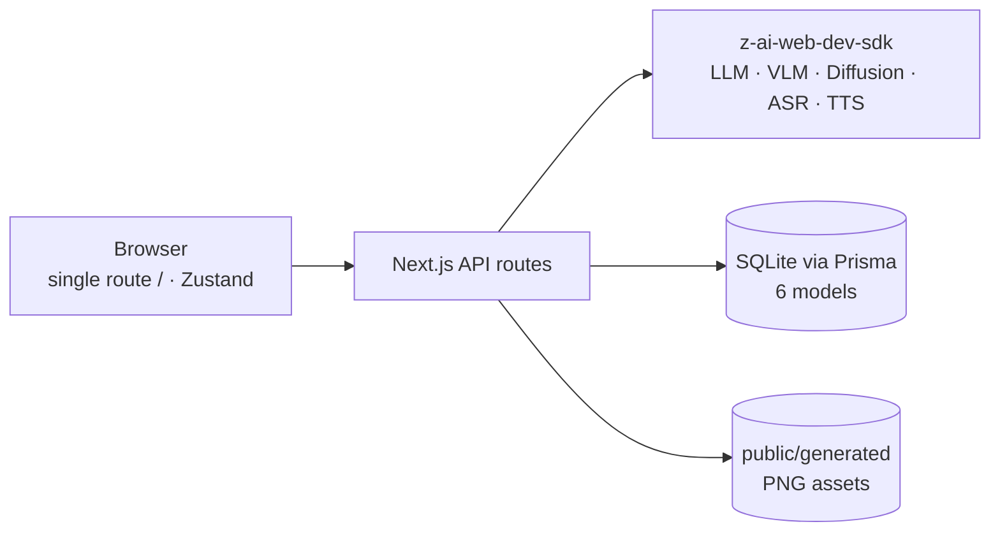
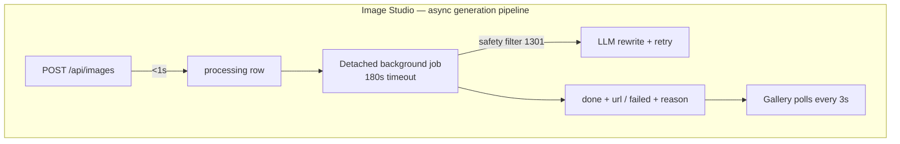

<div align="center">

# 🧠 Nexus AI Studio

**A multimodal AI platform — six AI capabilities, one production-grade app.**

Chat with streaming LLM · Long-term agent memory · Image understanding ·
Text-to-image with async job queue · Speech-to-text · Text-to-speech

[](https://nextjs.org)
[](https://www.typescriptlang.org)
[](https://react.dev)
[](https://tailwindcss.com)
[](https://www.prisma.io)
[](https://ui.shadcn.com)
[](https://www.sqlite.org)

[English](docs/DOCUMENTATION_EN.md) · [التوثيق العربي](docs/DOCUMENTATION_AR.md)

</div>

---

## ✨ What is this?

A full-stack AI portfolio project demonstrating how to ship **real** multimodal AI features — including the unglamorous parts nobody demos: safety-filter false positives, proxy timeouts, rate limits, and models that don't speak your users' language. Every feature was verified end-to-end in a real browser with a **zero-console-error policy**.

| Module | Highlights |
|---|---|
| 💬 **AI Chat** | Real SSE token streaming, markdown + syntax-highlighted code blocks, persistent conversations, voice input |
| 🧠 **Agent Memory** | 3-layer long-term memory: semantic facts (auto-extracted + deduped), episodic rolling summaries, working window — with a full management UI |
| 👁️ **Vision Analysis** | VLM-powered image understanding with structured markdown output |
| 🎨 **Image Studio** | Text-to-image with an **async job queue**: instant acknowledgement, live gallery polling, Arabic→English prompt auto-translation, safety-filter auto-rewrite, 5 aspect ratios |
| 🎙️ **Speech Lab** | STT + TTS with rate-limit-aware retries and honest language-support UX |
| 📊 **Dashboard** | Live stats, architecture diagram, engineering highlights |

**Plus a cross-cutting Prompt Optimizer**: in every prompt field, one click asks the system to meta-prompt an improved version (mode-specific strategies, same-language output, applied-rate analytics).

---

## 🏗️ Architecture

One user-visible route (`/`) with client-side view switching; all model calls happen server-side behind API routes — credentials never reach the client.





---

## 🚀 Quick start

```bash
bun install                 # or npm install
echo 'DATABASE_URL="file:./db/custom.db"' > .env
bun run db:push             # create SQLite schema
bun run dev                 # http://localhost:3000
```

> The AI layer uses `z-ai-web-dev-sdk` (server-side only, singleton in `src/lib/zai.ts`). Provide your own Z.AI credentials through the SDK's configuration mechanism — that file is the single integration point if you want to swap providers.

---

## 🧩 Engineering highlights (the good part)

These are real debugging stories, each verified end-to-end — details in [the docs](docs/DOCUMENTATION_EN.md#8-engineering-war-stories):

- **"Every generation fails" was a proxy-timeout illusion** — the edge proxy returned an HTML 504 page mid-generation while the server happily finished and saved every image (the same user prompt appeared 3× in the DB within 3 minutes). Fixed with the async job-queue architecture: no HTTP request can outlive any timeout.
- **Arabic prompts were false-flagged by the image safety filter** — the diffusion model can't parse Arabic script, so innocent prompts failed. Fixed with a Stage-0 LLM translation pass + an always-English safety rewriter.
- **A forensic ASR investigation** (5 probe scripts) proved the STT engine fundamentally lacks Arabic support — instead of pretending otherwise, the app ships script detection, amber accuracy warnings, and rate-limit-aware retries.
- **3-layer agent memory** with auto-extraction, unique-constraint dedupe, importance scoring, pinning, and rolling summaries — verified with cross-session recall tests.

---

## 📚 Documentation

- 📄 **[Complete English documentation](docs/DOCUMENTATION_EN.md)** — every module, endpoint, data model, and engineering decision
- 📄 **[التوثيق العربي الكامل](docs/DOCUMENTATION_AR.md)** — نفس المحتوى بالعربية

## 🛠️ Scripts

| Command | Description |
|---|---|
| `bun run dev` | Dev server on port 3000 |
| `bun run lint` | ESLint (ships clean) |
| `bun run db:push` | Sync Prisma schema to SQLite |

---

<div align="center">

**Built by [farid248](https://github.com/farid248)**

*Next.js 16 · React 19 · TypeScript · Tailwind 4 · shadcn/ui · Prisma · SQLite · TanStack Query · Zustand · Framer Motion*

</div>
