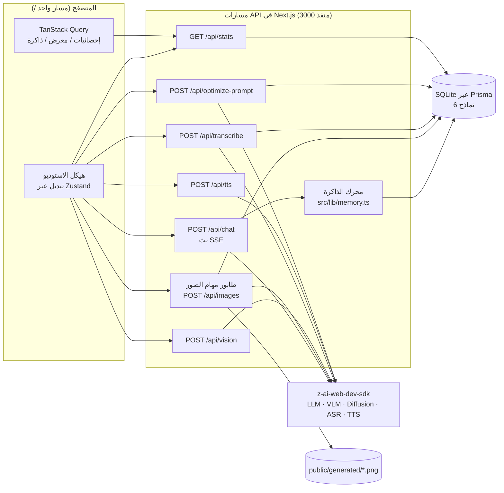
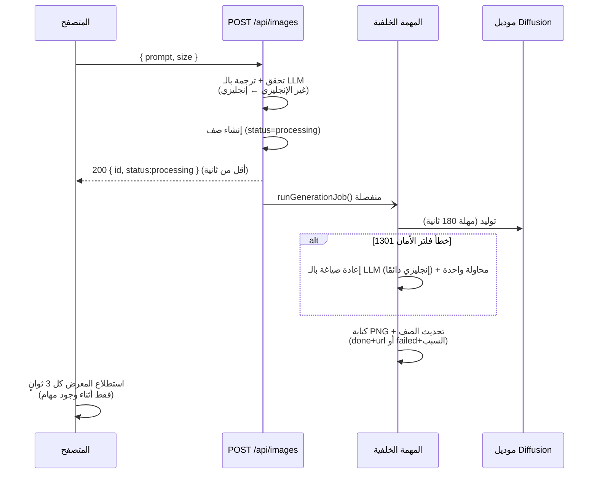

# Nexus AI Studio — التوثيق الكامل للمشروع (العربية)

> منصة ذكاء اصطناعي متعددة الوسائط (Multimodal) مبنية بمعايير إنتاجية كمشروع رئيسي لملف مهندس الذكاء الاصطناعي (AI Engineer Portfolio).
> هذا المستند هو السجل الهندسي الكامل لكل ما تم تصميمه وبناءه وتصحيحه والتحقق منه في المشروع.

---

## فهرس المحتويات

1. [نظرة عامة على المشروع](#1-نظرة-عامة-على-المشروع)
2. [التقنيات المستخدمة](#2-التقنيات-المستخدمة)
3. [معمارية النظام](#3-معمارية-النظام)
4. [الوحدات الست](#4-الوحدات-الست)
5. [الميزة العابرة للوحدات: محسّن البرومبت](#5-الميزة-العابرة-للوحدات-محسّن-البرومبت)
6. [مرجع الـ API](#6-مرجع-ال-api)
7. [مخطط قاعدة البيانات](#7-مخطط-قاعدة-البيانات)
8. [قصص هندسية: مشكلات حقيقية وكيف حُلَّت](#8-قصص-هندسية-مشكلات-حقيقية-وكيف-حُلَّت)
9. [تفاصيل هندسة الواجهة الأمامية](#9-تفاصيل-هندسة-الواجهة-الأمامية)
10. [منهجية التحقق والاختبار](#10-منهجية-التحقق-والاختبار)
11. [التشغيل محليًا](#11-التشغيل-محليًا)
12. [هيكل المشروع](#12-هيكل-المشروع)
13. [المطور](#13-المطور)

---

## 1. نظرة عامة على المشروع

**Nexus AI Studio** هو تطبيق ويب واحد يجمع **ست قدرات من قدرات الذكاء الاصطناعي** خلف واجهة واحدة:

| القدرة | نوع الموديل | الحالة |
|---|---|---|
| محادثة ذكية | LLM ببث مباشر (GLM) | ✅ يعمل — بث SSE |
| ذاكرة طويلة الأمد للوكيل | استخراج بالـ LLM + قاعدة بيانات | ✅ استخراج تلقائي + واجهة إدارة |
| فهم الصور | VLM (glm-5v-turbo) | ✅ رفع صورة ← تحليل منظم |
| توليد الصور | موديل Diffusion | ✅ نظام مهام غير متزامن + 5 نسب أبعاد |
| تحويل الكلام لنص | ASR | ✅ مع تجربة استخدام صادقة حول دعم اللغات |
| تحويل النص لكلام | TTS | ✅ 7 أصوات + سرعة قابلة للتعديل |

بُني المشروع من البداية للنهاية (واجهة + خلفية + قاعدة بيانات + تكاملات الذكاء الاصطناعي) بسياسة صارمة:
**أي ميزة لا تُطلق إلا بعد تحققٍ كامل end-to-end في متصفح حقيقي بصفر أخطاء في الكونسول.**

أهم ما يميز المشروع في السيرة الذاتية:

1. **محرك ذاكرة طويلة الأمد من 3 طبقات** — الوكيل يتذكر حقائق عن المستخدم بين الجلسات (دلالية)، ويلخّص المحادثات الطويلة (عرضية/Episodic)، ويحتفظ بنافذة عمل — مع واجهة إدارة كاملة.
2. **محسّن برومبت عابر للوحدات** — قبل تنفيذ أي برومبت، يستطيع النظام اقتراح نسخة محسّنة باستخدام استراتيجيات Meta-Prompting خاصة بكل وضع، مع تحليلات معدل التطبيق.
3. **خط توليد صور يعمل بنظام Job Queue غير متزامن** — مصمم حول قيود العالم الحقيقي (مهلات البروكسي، فلاتر الأمان، البرومبتات غير الإنجليزية) وليس حول المسار المثالي فقط.

---

## 2. التقنيات المستخدمة

| الطبقة | التقنية |
|---|---|
| الإطار | **Next.js 16** (App Router, Turbopack) |
| اللغة | **TypeScript 5** (صارم) |
| الواجهة | **React 19** + **shadcn/ui** (طقم كامل بنمط New York) + أيقونات **Lucide** |
| التنسيق | **Tailwind CSS 4** مع Theme Tokens مخصصة |
| الحركة | **Framer Motion** |
| حالة السيرفر | **TanStack Query v5** (استطلاع Polling، إبطال Cache، إعادة محاولة) |
| حالة العميل | **Zustand** (تبديل الوحدات وحالة الواجهة) |
| قاعدة البيانات | **Prisma ORM** + **SQLite** (`db/custom.db`) |
| SDK الذكاء الاصطناعي | **z-ai-web-dev-sdk** — على السيرفر فقط (LLM محادثة، VLM، Diffusion، ASR، TTS) |
| Markdown | react-markdown + react-syntax-highlighter |
| الثيم | next-themes (داكن افتراضيًا + فاتح) |
| التواريخ | date-fns |
| فحص الكود | ESLint 9 + eslint-config-next |

> الـ SDK نسخة Singleton في `src/lib/zai.ts` ويُستورد **حصريًا داخل مسارات الـ API** — أي بيانات اعتماد للموديلات لا تصل أبدًا إلى كود المتصفح.

---

## 3. معمارية النظام

التطبيق يعرض **مسارًا واحدًا مرئيًا للمستخدم** (`/`) مع تبديل الوحدات على جانب العميل (client-side)، مما يمنح إحساس تطبيق SPA بسرعة تنقل فورية، بينما كل أعمال الذكاء الاصطناعي تحدث خلف مسارات API على السيرفر.



**أهم القرارات المعمارية:**

- **عزل الـ SDK على السيرفر** — كل استدعاء موديل يحدث داخل مسار API؛ العميل يتحدث JSON/SSE/Binary فقط مع `/api/*`.
- **SQLite لكل شيء** — المحادثات والرسائل والذكريات والصور والتحويلات الصوتية وتحسينات البرومبت كلها محفوظة؛ التطبيق يصمد أمام إعادة التحميل الكاملة.
- **تخزين الملفات الثابتة** — الصور المتولدة تُكتب في `public/generated/` وتُخدَّم كملفات ثابتة؛ يُخزَّن الـ URL فقط في قاعدة البيانات.
- **الدردشة بثًا أولًا (Streaming-first)** — مسار الدردشة يمرّر تدفق الـ SSE من الـ LLM مباشرة إلى المتصفح عبر `TransformStream` مع تجميع التوكنات على السيرفر لأغراض الحفظ.
- **مهام خلفية منفصلة (Detached)** — توليد الصور يعمل كمهمة async تعمل حتى لو أغلق المتصفح.

---

## 4. الوحدات الست

### 4.1 لوحة التحكم (Dashboard)

- **إحصائيات استخدام حية** — المحادثات، الرسائل، الصور، التحويلات الصوتية، الذكريات، البرومبتات المحسّنة (TanStack Query مع تحديث دوري؛ كل رقم هو Count حقيقي من قاعدة البيانات).
- **بطاقات الوحدات** — بطاقة لكل وحدة مع وصف قصير؛ الضغط ينتقل إلى الوحدة.
- **مخطط معمارية النظام** — خريطة بصرية للمنصة كاملة (الواجهة ← مسارات API ← موديلات الـ SDK ← قاعدة البيانات).
- **أبرز الإنجازات الهندسية** — قائمة منسّقة من الانتصارات التقنية (الذاكرة ثلاثية الطبقات، محسّن البرومبت، الطابور غير المتزامن، أنماط الصمود Resilience).
- **شريط أحدث التوليدات** — آخر 6 صور متولدة.
- قسم Hero + دعم الوضع الداكن/الفاتح + تصميم متجاوب بالكامل.

### 4.2 المحادثة الذكية (AI Chat)

- **بث SSE حقيقي** — التوكنات تظهر لحظة وصولها مع مؤشر كتابة متحرك؛ الرد يُحفظ على السيرفر عند انتهاء التدفق.
- **إدارة المحادثات** — لوحة تاريخ (جانبية على الديسكتوب + Sheet منسدل على الموبايل)، حذف مع Cascade، عناوين المحادثات، محادثة جديدة.
- **معالجة السياق** — نافذة عمل من آخر 16 رسالة + ملخص متجدد + كتلة الذاكرة (انظر 4.3) تُرسل كسياق.
- **عرض Markdown** — عناوين وقوائم وجداول و**بلوكات كود بتلوين Syntax وزر نسخ بضغطة واحدة**.
- **إدخال صوتي** — زر المايك يسجل عبر `MediaRecorder`، يرسل الصوت إلى `/api/transcribe`، ويضع النص في صندوق الكتابة.
- **شريحة الذاكرة** — تعرض عدد الذكريات الحي؛ الضغط ينقل لشاشة الذاكرة.
- **عصا محسّن البرومبت** — نقرة واحدة تقترح برومبت محسّن (انظر §5).

### 4.3 ذاكرة الوكيل — محرك الذاكرة ثلاثي الطبقات

الميزة الرئيسية للمشروع. `src/lib/memory.ts` ينفّذ ثلاث طبقات ذاكرة متكاملة، تحاكي الطريقة التي تدير بها أطر العمل الإنتاجية للوكلاء السياق طويل الأمد:

| الطبقة | ماذا تخزن | الآلية |
|---|---|---|
| **1. الدلالية (Semantic)** | حقائق دائمة عن المستخدم | بعد كل تبادل، تمريرة LLM خلفية تستخرج الحقائق كـ JSON صارم؛ الصفوف تُمنع من التكرار بقيد `unique` على المحتوى، وتُصنّف (شخصي / تفضيل / هدف / مهارة / مشروع / حقيقة) وتُقيَّم بأهمية 1–5. |
| **2. العرضية (Episodic)** | ملخص متجدد للمحادثات الطويلة | عندما تتجاوز المحادثة 24 رسالة، تُلخَّص الرسائل الأقدم (خارج نافذة العمل ذات الـ 16 رسالة) بواسطة LLM في `Conversation.summary` على دفعات لا تقل عن 4 رسائل. |
| **3. نافذة العمل (Working Window)** | السياق الحديث | آخر 16 رسالة تُرسل دائمًا كما هي. |

**الحقن:** كل طلب دردشة يبني System Prompt = الشخصية الأساسية + كتلة الذاكرة (~أعلى 60 ذكرى مرتبة: مثبتة ← أهمية ← حداثة) + ملخص المحادثة + توجيهات الاستخدام ("لا تُعدّ الذكريات قائمة أبدًا؛ رُدّ بلغة المستخدم"). مع زيادة `useCount` (Fire-and-forget) لتتبع الذكريات المستخدمة فعليًا.

**واجهة الإدارة (شاشة Memory):**
- شريط إحصائيات (الإجمالي / المثبتة / المستخرجة تلقائيًا).
- بحث + شرائح فلترة حسب التصنيف.
- نوافذ إضافة/تعديل مع نقاط الأهمية ومفتاح التثبيت.
- لكل بطاقة: تثبيت / تعديل / حذف + **حذف الكل** خلف AlertDialog.
- قسم "كيف تعمل".

**سلوك تم التحقق منه:** إخبار الوكيل "اسمي عمر، مهندس AI من القاهرة…" أنتج 6 ذكريات مصنفة؛ محادثة **جديدة تمامًا** استدعت كل الحقائق بدقة؛ حقائق جديدة (مثل "يحب الأكل المصري خصوصًا الكشري") استُخرجت تلقائيًا أثناء الجلسة؛ ومحادثة مُضافة تجريزيًا بـ 30 رسالة حصلت على ملخص متجدد دقيق بعد تبادل واحد إضافي.

### 4.4 تحليل الصور (Vision)

- سحب وإفلات **و** منتقي ملفات مع معاينة.
- الصورة تُرسل كـ base64 Data URL إلى الـ VLM (glm-5v-turbo) عبر `/api/vision`.
- برومبتات جاهزة + أسئلة حرة؛ الإجابات تُعرض كـ Markdown غني (OCR، كائنات، مشاهد، علاقات).
- تكامل مع محسّن البرومبت (وضع vision).

### 4.5 استوديو الصور — خط توليد غير متزامن (Job Queue)

تحويل نص إلى صورة مع **خمس نسب أبعاد** (1024×1024، 1152×864، 1344×768، 864×1152، 768×1344) ومعرض دائم. خط التوليد غير متزامن بالكامل:



- **إقرار فوري** — الـ POST يرجع في أقل من ثانية؛ الواجهة تعرض بطاقات "جارٍ الرسم…" متحركة تتحول للصور الحقيقية عبر الاستطلاع.
- **يصمد أمام انقطاع الاتصال** — التوليد يكمل على السيرفر حتى لو أُغلق التاب.
- **حالات الفشل مواطن من الدرجة الأولى** — المهام الفاشلة تُعرض كبطاقات مع سبب مقروء؛ أخطاء 429 (Rate limit) و 1301 (فلتر الأمان) لها رسائل مخصصة.
- **عرض بالنسبة الحقيقية** — صور المعرض تُعرض كاملة بإطارها الحقيقي دون قصّ مربع.
- بطاقات المعرض بها طبقة Hover تعرض البرومبت والمقاس والوقت وأزرار تحميل وحذف.
- تكامل مع محسّن البرومبت (وضع image).

### 4.6 مختبر الكلام (Speech Lab — STT + TTS)

**لوحة تحويل الكلام لنص:**
- رفع ملف صوتي **أو** تسجيل من المايك.
- النصوص المحوَّلة تُحفظ (نموذج `Transcription`) مع قائمة تاريخ.
- **إعادة محاولة واعية بحدود المعدل** — أخطاء 429 تُعاد محاولتها بتراجع أُسّي (5 ثوانٍ ← 10 ثوانٍ، محاولتان) قبل إظهار رسالة ودّية "انتظر بضع دقائق".
- **تجربة استخدام صادقة حول دعم اللغات** — محرك ASR يدعم الإنجليزية والصينية؛ النصوص العربية تُكتشف (بتحليل المحارف/Script) وتُعلَّم بتحذير كهرماني عن الدقة بدلًا من عرض نص سيئ بصمت. ومايك الدردشة يعرض Toast غير مدمّر عند اكتشاف إدخال صوتي عربي.

**لوحة تحويل النص لكلام:**
- 7 أصوات، منزلق سرعة (0.5×–2.0×)، حد 1024 حرف، ملف WAV يُشغَّل في مشغل مدمج مع زر تحميل.
- نفس إعادة المحاولة والأخطاء الودّية؛ وإشعار كهرماني يوضح أن الأصوات مضبوطة للإنجليزية/الصينية.

---

## 5. الميزة العابرة للوحدات: محسّن البرومبت

متاح في **الوحدات الثلاث التي تعتمد البرومبت** (دردشة، استوديو الصور، تحليل الصور) عبر زر العصا السحرية.

- **استراتيجيات Meta-Prompting خاصة بكل وضع:**
  - `chat` — يضيف الدور والسياق والقيادات وشكل المخرجات؛ ويحل الإشارات الغامضة مستخدمًا آخر 6 رسائل من المحادثة.
  - `image` — يُثرى البرومبت بكلمات الموضوع/الأسلوب/الإضاءة/التكوين/الكاميرا (~80 كلمة، دون صياغة سلبية).
  - `vision` — يهيكل ما يجب تحليله وشكل الإجابة المتوقع.
- **المخرجات بنفس اللغة** — برومبت عربي يحصل على تحسين عربي مع ملاحظات تحسين بالعربية.
- **نافذة مقارنة** — الأصلي مقابل المحسّن جنبًا إلى جنب + قائمة "ما الذي تحسّن" + ملخص؛ خيارا *الإبقاء على الأصلي* أو *استخدام المحسّن*.
- **تحليلات معدل التطبيق** — كل تحسين يُسجَّل (`PromptOptimization`)؛ وتطبيقه يقلب علامة `applied`، مما يغذي إحصائية "برومبتات محسّنة" في لوحة التحكم.

---

## 6. مرجع الـ API

| الطريقة | المسار | الغرض |
|---|---|---|
| `GET` | `/api` | فحص صحة / ترحيب. |
| `POST` | `/api/chat` | بث SSE للتوكنات. يحفظ رسائل المستخدم والمساعد؛ يعيد `X-Conversation-Id`؛ يشغّل استخراج الذاكرة والملخص المتجدد في الخلفية. |
| `GET` | `/api/conversations` | قائمة المحادثات للوحة التاريخ. |
| `GET` | `/api/conversations/[id]` | كامل رسائل محادثة واحدة. |
| `DELETE` | `/api/conversations/[id]` | حذف محادثة (الرسائل تُحذف Cascade). |
| `POST` | `/api/vision` | فهم الصور — المتن: `{ imageDataUrl, prompt }` ← تحليل Markdown. |
| `POST` | `/api/images` | **إدراج** مهمة توليد صورة — يتحقق، يترجم غير الإنجليزي بالـ LLM، ينشئ صف `processing`، يطلق المهمة الخلفية، ويرجع فورًا. |
| `GET` | `/api/images` | المعرض (أحدث 48، يشمل صفوف `processing`/`failed` لأغراض الاستطلاع). |
| `DELETE` | `/api/images/[id]` | حذف صورة (الصف + الملف؛ آمن مع الـ URL الفارغ). |
| `POST` | `/api/transcribe` | STT — صوت Multipart ← base64 ← ASR؛ إعادة محاولة 429 + كشف المحارف + `qualityWarning`. |
| `GET` | `/api/transcriptions` | تاريخ التحويلات. |
| `POST` | `/api/tts` | TTS — `{ text, voice, speed }` ← ملف `audio/wav` ثنائي؛ مع تحقق وتثبيت القيم. |
| `GET` | `/api/stats` | تجميعات لوحة التحكم + آخر 6 صور مكتملة. |
| `GET` `POST` | `/api/memories` | عرض / إضافة ذكريات (الإضافة اليدوية تعمل Upsert عند التكرار). |
| `PATCH` `DELETE` | `/api/memories` | تعديل/تثبيت واحدة (`?id=`) أو حذف الكل (`?all=true`). |
| `POST` | `/api/optimize-prompt` | تمريرة Meta-Prompting — `{ prompt, mode, conversationId? }` ← برومبت محسّن + ملاحظات التحسين. |
| `PATCH` | `/api/optimize-prompt?id=` | تعليم تحسين بأنه طُبِّق. |

---

## 7. مخطط قاعدة البيانات

```prisma
model Conversation {
  id                  String    @id @default(cuid())
  title               String    @default("New Chat")
  createdAt           DateTime  @default(now())
  updatedAt           DateTime  @updatedAt
  summary             String?              // الذاكرة العرضية (ملخص متجدد)
  summaryMessageCount Int       @default(0)
  messages            Message[]
}

model Message {
  id             String       @id @default(cuid())
  conversationId String
  conversation   Conversation @relation(fields: [conversationId], references: [id], onDelete: Cascade)
  role           String                 // "user" | "assistant"
  content        String
  createdAt      DateTime     @default(now())
  @@index([conversationId, createdAt])
}

model Memory {
  id         String    @id @default(cuid())
  content    String    @unique          // مفتاح منع التكرار للاستخراج التلقائي
  category   String    @default("fact") // personal|preference|goal|skill|project|fact
  importance Int       @default(3)      // من 1 إلى 5
  pinned     Boolean   @default(false)
  source     String    @default("auto") // auto | manual
  useCount   Int       @default(0)
  lastUsedAt DateTime?
  createdAt  DateTime  @default(now())
  updatedAt  DateTime  @updatedAt
  @@index([pinned, importance, updatedAt])
}

model GeneratedImage {
  id           String    @id @default(cuid())
  prompt       String                 // البرومبت الفعّال (المترجم/المُعاد صياغته)
  size         String
  url          String?                // فارغ أثناء المعالجة أو عند الفشل
  status       String    @default("done") // processing | done | failed
  errorMessage String?
  createdAt    DateTime  @default(now())
}

model Transcription {
  id        String   @id @default(cuid())
  fileName  String
  text      String
  duration  Float?
  createdAt DateTime @default(now())
}

model PromptOptimization {
  id              String   @id @default(cuid())
  originalPrompt  String
  optimizedPrompt String
  mode            String   @default("chat") // chat | image | vision
  improvements    String   @default("")      // مصفوفة JSON من الملاحظات
  applied         Boolean  @default(false)
  createdAt       DateTime @default(now())
}
```

---

## 8. قصص هندسية: مشكلات حقيقية وكيف حُلَّت

أثمن ما في هذا المشروع هو ما تعلمناه **من تصحيح أعطال حقيقية**. كل قصة أدناه قابلة لإعادة الإنتاج، وقد تم التحقق من الإصلاح End-to-End.

### 8.1 البرومبتات العربية كانت تُرفض زورًا بواسطة فلتر أمان الصور

- **العَرَض:** برومبتات عربية بريئة تمامًا (مثل *"مدينة عائمة فوق السحاب عند الغروب"*) تفشل بخطأ `1301` (فلتر محتوى)، بينما نفس البرومبت بالإنجليزية ينجح.
- **التشخيص:** موديل الـ Diffusion لا يفهم المحارف العربية؛ فلتر الأمان يعلّم أي شيء غير مفهوم له بأنه غير آمن. ومُعيد الصياغة الآمن الموجود كان يرد بنفس لغة المدخل — فكانت إعادة كتابته العربية تفشل أيضًا.
- **الإصلاح:** **تمريرة ترجمة Stage-0** — أي برومبت عربي (أو أي محارف غير لاتينية/صينية) يُترجم بالـ LLM إلى برومبت Diffusion إنجليزي غني *قبل* استدعاء API الصور، مع تعليم مُعيد الصياغة بأن يرد بالإنجليزية دائمًا. والواجهة تعرض Toast شفاف بالبرومبت المترجم.
- **النتيجة:** البرومبت الذي كان يفشل يتولد في ~36 ثانية بترجمة إنجليزية أمينة.

### 8.2 "كل توليد يفشل" — وهم مهلة البروكسي

- **العَرَض:** كل طلب صورة يرجع `Generation failed — Unexpected token '<', "<html> <h"...` — كانت الواجهة تستلم صفحة HTML لخطأ **504 Gateway Time-out** بدل JSON.
- **التشخيص (المفاجأة):** قاعدة البيانات أظهرت 25 صورة متولدة بنجاح — بما فيها *نفس البرومبت ثلاث مرات في ثلاث دقائق* (04:29، 04:30، 04:31). المستخدم كان يعيد المحاولة لأن المتصفح يعرض خطأ، بينما السيرفر يكمل ويحفظ كل توليد بنجاح. الـ Diffusion يستغرق 25–80 ثانية؛ والبروكسي الخارجي كان يقطع الاتصال في المنتصف.
- **الإصلاح:** **معمارية الطابور غير المتزامن** (§4.5) — الطلب يرجع في أقل من ثانية، والمهمة تعمل منفصلة بمهلة أمان 180 ثانية، والمعرض يستطلع. لم يعد أي HTTP Request يستطيع أن يتجاوز مهلة أي بروكسي.
- **إصلاحات إضافية اكتُشفت في الطريق:** صور المعرض تُعرض الآن بنسبها الحقيقية (كانت تُقصّ مربعًا)، وكل الـ 25 صورة "المفقودة" أصبحت مرئية للمستخدم.

### 8.3 "موديل الـ STT سيئ جدًا جدًا" — تحقيق جنائي في ASR

- **العَرَض:** المستخدم أبلغ عن جودة تحويل صوتية كارثية.
- **التحقيق (5 سكربتات فحص، محفوظة كدليل):**
  - اختبار ذهاب-وعودة إنجليزي (TTS→ASR): **100% مثالي**، حتى مع خلط ضوضاء.
  - الاختبار العربي: حروف لفظية بلا معنى.
  - فحص الصيغ: webm/opus من مايك حقيقي يتحول بشكل ممتاز ← **ليست مشكلة صيغة**.
  - فحص الموديل والبارامترات: حقول `model` و `language` و `locale` و `prompt` كلها تُتجاهل من الـ Endpoint.
  - فحص إبداعي: تغليف الصوت في mp4 للـ VLM ← يعالج الإطارات لكن يعيد محتوى فارغًا ← لا يوجد Modality صوتي.
- **الحكم:** محرك ASR يدعم الإنجليزية والصينية فقط — قيد من المنصة المصدرية، غير قابل للإصلاح من جهة العميل.
- **التخفيفات المُنفَّذة:** `withRateLimitRetry` (تراجع أُسّي عند 429)، رسائل ودّية لحدود المعدل، كشف المحارف (`detectScript`)، تحذيرات كهرمانية لكل نص عربي، Toast لمايك الدردشة، وإشعارات صادقة عن دعم اللغات.
- **الخلاصة للسيرة الذاتية:** *قِس ولا تخمّن* — نفس الشكوى كان يمكن "إصلاحها" بثلاث محاولات عديمة الفائدة؛ بدلًا من ذلك حُلَّت من جذرها بمصفوفة فحص قابلة لإعادة الإنتاج.

### 8.4 حدود معدل (Rate Limiting) شرسة على مسارات الصوت

- الاستخدام المتفجر لـ ASR/TTS كان يظهر أخطاء `429 Too many requests` خام للمستخدمين؛ ونافذة التعافي قيست بـ 3–13 دقيقة.
- **الإصلاح:** `withRateLimitRetry` + رسائل مخصصة ("انتظر بضع دقائق")، مع التحقق بسكربت Mock.

### 8.5 ردود المساعد كانت تختفي في المحادثات الجديدة

- **السبب الجذري:** Closure قديم لـ `conversationId` في بلوك `finally` للدردشة — بعد أن عيّن السيرفر معرف محادثة *جديدًا* (عبر `X-Conversation-Id`)، كانت الواجهة تعيد جلب المعرف *القديم* (الفارغ).
- **الإصلاح:** التقاط معرف المحادثة الفعّال محليًا من ترويسة الاستجابة قبل تشغيل بلوك finally.

### 8.6 إدارة عملية سيرفر التطوير داخل الـ Sandbox

- الـ Sandbox يقتل العمليات المولّدة من الجلسة عند نهاية استدعاءات الأدوات؛ `nohup … &` البسيط يموت مع الجلسة.
- **النمط:** Double-fork عبر `bash -c 'nohup cmd &disown'` يعيد تبنّي سيرفر التطوير لـ PID 1 فيصمد. (وأيضًا: إعادة توليد Prisma Client تتطلب دائمًا إعادة تشغيل سيرفر التطوير.)

### 8.7 حد مدة الصوت

- يفرض Endpoint الـ ASR حد 0–30 ثانية لكل ملف (خطأ `1214`)؛ الواجهة تعرضه كرسالة تحقق واضحة بدل خطأ 500 خام.

---

## 9. تفاصيل هندسة الواجهة الأمامية

- **هيكل التطبيق** — عمود Flex بارتفاع `h-dvh`: ترويسة + (شريط جانبي للديسكتوب / تابات أفقية للموبايل) + حاوية الوحدات + **Footer مثبّت أسفل الشاشة** (عبر `mt-auto`، يحترم Safe-area Insets؛ تم التحقق عند 390px و 1440px).
- **الثيم** — داكن افتراضيًا عبر next-themes؛ لوحة زمردية (Emerald)؛ Scrollbars مخصصة؛ مؤشر كتابة متحرك أثناء البث.
- **سياسة التجاوب** — Mobile-first؛ كل شاشة تم التحقق منها عند 390px؛ أهداف اللمس ≥ 44px؛ النوافذ مقيدة بـ `max-h-[90dvh]` مع تمرير داخلي.
- **إمكانية الوصول** — عناصر دلالية (`main/header/nav/section`)، تسميات ARIA على كل أزرار الأيقونات، دعم `sr-only`، عناصر قابلة للتنقل بلوحة المفاتيح، حلقات تركيز Focus Rings.
- **حالات التحميل والخطأ** — Skeletons للمعارض والقوائم، Spinners على الأزرار غير المتزامنة، Toasts تدميرية برسائل قابلة للتنفيذ، وأزرار إعادة محاولة في محسّن البرومبت.
- **القوائم الطويلة** — ارتفاعات مقيدة مع تمرير داخلي وScrollbars منسّقة.
- **Fetch مقاوم لـ JSON التالف** — استجابات الـ API تُقرأ بـ `.json().catch(() => null)` حتى لا تُكسر الواجهة أبدًا برسالة "Unexpected token '<'" إذا صدر HTML غير متوقع.

---

## 10. منهجية التحقق والاختبار

كل ميزة تم التحقق منها بنفس الحلقة الصارمة:

1. **اختبار على مستوى الـ API** — استدعاءات `curl` مباشرة (أكواد الحالة، شكل البيانات، التوقيت).
2. **E2E عبر المتصفح** — أتمتة متصفح Headless: النقر عبر مسار واجهة حقيقي (املأ البرومبت ← أرسل ← راقب النتيجة).
3. **تدقيق بصري** — لقطات شاشة تفحصها موديلات الرؤية (التخطيط، التباين، لا تداخل ولا اقتصاص).
4. **سياسة صفر أخطاء** — أخطاء الصفحة والكونسول يجب أن تكون فارغة تمامًا.
5. **نظافة البيانات** — الصفوف/الملفات التجريبية التي أُنشئت أثناء التحقق تُحذف بعده؛ وبيانات المستخدم الحقيقية لا تُلمس أبدًا.

تشمل السيناريوهات المتحقق منها: بث SSE مع بلوكات كود Markdown؛ استدعاء الذاكرة بين الجلسات؛ الملخصات المتجددة؛ تطبيق المحسّن وتحليلاته؛ برومبتات الصور العربية من البداية للنهاية؛ استطلاع المهام غير المتزامنة؛ تحليل الرؤية؛ اختبارات ذهاب-وعودة TTS/ASR؛ تخطيطات الموبايل والديسكتوب؛ والـ Footer المثبّت.

---

## 11. التشغيل محليًا

### المتطلبات المسبقة

- **Node.js 20+** أو **Bun 1.1+** (الموصى به: Bun)
- بيئة **z-ai-web-dev-sdk** مضبوطة (يُهيَّأ الـ SDK عبر `ZAI.create()` في `src/lib/zai.ts`؛ وهو يتوقع توفر بيانات اعتماد/إعدادات المنصة في بيئة التشغيل — في الـ Sandbox الأصلي للمشروع كانت مُوفَّرة من المنصة. لنشرك الخاص، وفّر بيانات اعتماد Z.AI الخاصة بك عبر آلية إعداد الـ SDK — و`src/lib/zai.ts` هي نقطة التكامل الوحيدة للاستبدال).

### الخطوات

```bash
# 1. تثبيت الاعتماديات
bun install        # أو: npm install

# 2. البيئة
echo 'DATABASE_URL="file:./db/custom.db"' > .env
# (مجلد db/ يجب أن يوجد؛ ملف SQLite ينشئه Prisma)

# 3. إنشاء مخطط قاعدة البيانات
bun run db:push    # prisma db push

# 4. تشغيل سيرفر التطوير
bun run dev        # http://localhost:3000
```

### سكربتات مفيدة

| السكربت | ماذا يفعل |
|---|---|
| `bun run dev` | سيرفر تطوير Next.js على منفذ 3000 (السجلات في `dev.log`). |
| `bun run lint` | ESLint (المشروع يُسلَّم نظيفًا). |
| `bun run db:push` | مزامنة `prisma/schema.prisma` مع SQLite. |
| `bun run db:generate` | إعادة توليد Prisma Client (أعد تشغيل سيرفر التطوير بعدها!). |

> **ملاحظة حول Caddyfile:** يضم المستودع `Caddyfile` كان يستخدمه بواب الـ Sandbox الأصلي (منفذ خارجي واحد + توجيه بالاستعلام `XTransformPort` للخدمات المصغرة). ليس مطلوبًا للتطوير المحلي — يُوثّق طوبولوجيا النشر فقط.

---

## 12. هيكل المشروع

```
nexus-ai-studio/
├── docs/
│   ├── DOCUMENTATION_EN.md      # التوثيق الإنجليزي
│   └── DOCUMENTATION_AR.md      # هذا الملف
├── prisma/
│   └── schema.prisma            # 6 نماذج (Conversation, Message, Memory,
│                                 #   GeneratedImage, Transcription, PromptOptimization)
├── public/
│   ├── logo.svg
│   ├── robots.txt
│   └── generated/               # الصور المتولدة تُكتب هنا وقت التشغيل
├── src/
│   ├── app/
│   │   ├── api/
│   │   │   ├── chat/route.ts             # بث SSE + حفظ + خطافات الذاكرة
│   │   │   ├── conversations/route.ts    # القائمة
│   │   │   ├── conversations/[id]/route.ts
│   │   │   ├── images/route.ts           # طابور المهام (POST) + المعرض (GET)
│   │   │   ├── images/[id]/route.ts      # حذف
│   │   │   ├── memories/route.ts         # CRUD كامل
│   │   │   ├── optimize-prompt/route.ts  # Meta-prompting + تحليلات التطبيق
│   │   │   ├── stats/route.ts
│   │   │   ├── transcribe/route.ts       # ASR + إعادة محاولة + كشف المحارف
│   │   │   ├── transcriptions/route.ts
│   │   │   ├── tts/route.ts              # ملف WAV ثنائي
│   │   │   ├── vision/route.ts           # VLM
│   │   │   └── route.ts                  # فحص صحة
│   │   ├── globals.css                   # Theme Tokens و Scrollbars والحركات
│   │   ├── layout.tsx
│   │   └── page.tsx                      # المسار الوحيد المرئي للمستخدم
│   ├── components/
│   │   ├── studio/
│   │   │   ├── ai-studio.tsx             # هيكل التطبيق (ترويسة/شريط/تابات/Footer)
│   │   │   ├── markdown.tsx              # Markdown + تلوين + نسخ
│   │   │   ├── prompt-optimizer.tsx      # ويدجت المحسّن + نافذة الحوار
│   │   │   ├── sidebar.tsx
│   │   │   ├── theme-provider.tsx
│   │   │   └── views/
│   │   │       ├── chat-view.tsx         # عميل SSE + تاريخ + مايك + Composer
│   │   │       ├── dashboard-view.tsx
│   │   │       ├── image-studio-view.tsx # معرض بالاستطلاع + بطاقات المهام
│   │   │       ├── memory-view.tsx       # واجهة إدارة الذاكرة
│   │   │       ├── speech-view.tsx       # لوحتا STT و TTS
│   │   │       └── vision-view.tsx
│   │   └── ui/                           # طقم مكونات shadcn/ui
│   ├── hooks/
│   │   ├── use-mobile.ts
│   │   ├── use-toast.ts
│   │   └── use-voice-recorder.ts         # غلاف MediaRecorder لمايك الدردشة
│   └── lib/
│       ├── db.ts                         # Prisma Client Singleton
│       ├── memory.ts                     # محرك الذاكرة ثلاثي الطبقات
│       ├── retry.ts                      # withRateLimitRetry + detectScript
│       ├── studio-store.ts               # مخزن Zustand (تبديل الوحدات)
│       ├── types.ts                      # DTOs مشتركة
│       ├── utils.ts                      # cn() وغيرها
│       └── zai.ts                        # Singleton الـ SDK (سيرفر فقط)
├── .env                                  # DATABASE_URL (غير مرفوع للمستودع)
├── Caddyfile                             # طوبولوجيا بوابة الـ Sandbox (توثيق)
└── package.json
```

---

## 13. المطور

**farid248** — [github.com/farid248](https://github.com/farid248)

بُني كمشروع ملف (Portfolio) لمهندس ذكاء اصطناعي يُظهر: تكامل وسائط متعددة، معماريات البث (Streaming)، الذاكرة طويلة الأمد للوكلاء، الـ Meta-Prompting، طوابير المهام غير المتزامنة، والتصحيح الإنتاجي لقيود الموديلات والمنصات في العالم الحقيقي.
