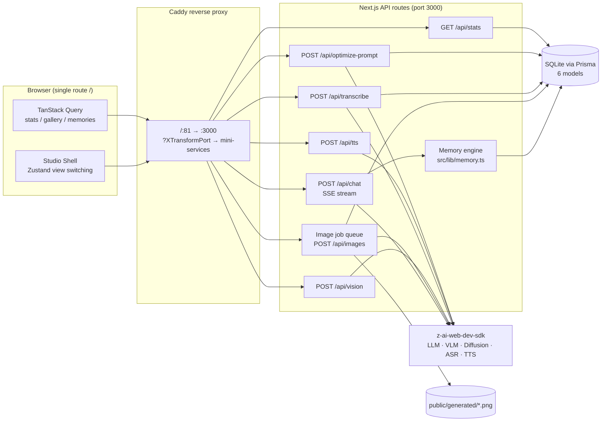
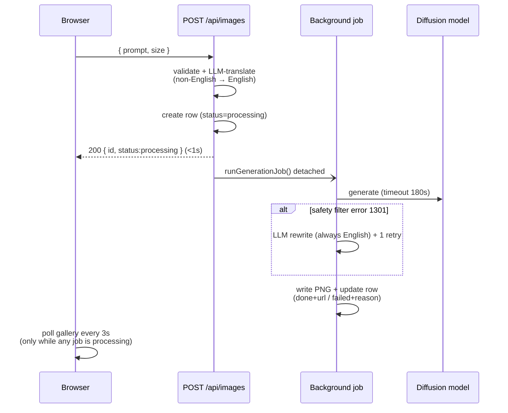

# Nexus AI Studio — Complete Project Documentation (English)

> A production-grade multimodal AI platform built as a flagship AI-Engineering portfolio project.
> This document is the full engineering record of everything designed, built, debugged and verified in the project.

---

## Table of Contents

1. [Project Overview](#1-project-overview)
2. [Tech Stack](#2-tech-stack)
3. [System Architecture](#3-system-architecture)
4. [The Six Modules](#4-the-six-modules)
   - 4.1 Dashboard
   - 4.2 AI Chat
   - 4.3 Agent Memory (3-Layer)
   - 4.4 Vision Analysis
   - 4.5 Image Studio (Async Job Queue)
   - 4.6 Speech Lab (STT + TTS)
5. [Cross-Cutting Feature: Prompt Optimizer](#5-cross-cutting-feature-prompt-optimizer)
6. [API Reference](#6-api-reference)
7. [Database Schema](#7-database-schema)
8. [Engineering War Stories — Problems, Diagnosis & Fixes](#8-engineering-war-stories)
9. [Frontend Engineering Details](#9-frontend-engineering-details)
10. [Verification Methodology](#10-verification-methodology)
11. [Setup & Running Locally](#11-setup--running-locally)
12. [Project Structure](#12-project-structure)
13. [Author](#13-author)

---

## 1. Project Overview

**Nexus AI Studio** is a single web application that unifies **six AI modalities** behind one interface:

| Capability | Model class | Status |
|---|---|---|
| Conversational AI | Streaming LLM (GLM) | ✅ Live, SSE streaming |
| Long-term agent memory | LLM extraction + SQLite | ✅ Auto-extraction + management UI |
| Image understanding | Vision LLM (glm-5v-turbo) | ✅ Upload → structured analysis |
| Image generation | Diffusion model | ✅ Async job queue, 5 aspect ratios |
| Speech-to-Text | ASR | ✅ With honest language-support UX |
| Text-to-Speech | TTS | ✅ 7 voices, adjustable speed |

The project was built end-to-end (frontend, backend, database, AI integrations) with a strict policy:
**every feature ships only after a full end-to-end verification in a real browser with zero console errors.**

Two features make this project stand out on a CV:

1. **A 3-layer long-term memory engine** — the agent remembers facts about the user across sessions (semantic), summarizes long conversations (episodic), and keeps a working window — with a full management UI on top.
2. **A cross-cutting Prompt Optimizer** — before any prompt is executed, the system can suggest an improved version using mode-specific meta-prompting strategies, with applied-rate analytics.
3. **An async job-queue image pipeline** — designed around real-world constraints (edge-proxy timeouts, safety filters, non-English prompts) rather than the happy path.

---

## 2. Tech Stack

| Layer | Technology |
|---|---|
| Framework | **Next.js 16** (App Router, Turbopack) |
| Language | **TypeScript 5** (strict) |
| UI | **React 19**, **shadcn/ui** (New York style, full component set), **Lucide** icons |
| Styling | **Tailwind CSS 4**, custom theme tokens, `tw-animate-css` |
| Animation | **Framer Motion** |
| Server state | **TanStack Query v5** (polling, invalidation, retries) |
| Client state | **Zustand** (view switching, UI state) |
| Database | **Prisma ORM** + **SQLite** (`db/custom.db`) |
| AI SDK | **z-ai-web-dev-sdk** — server-side only (chat LLM, VLM, diffusion, ASR, TTS) |
| Markdown | react-markdown + react-syntax-highlighter |
| Theming | next-themes (dark default, light supported) |
| Dates | date-fns |
| Linting | ESLint 9 + eslint-config-next |

> The AI SDK singleton lives in `src/lib/zai.ts` and is **imported exclusively inside API routes** — no model credentials ever reach the client bundle.

---

## 3. System Architecture

The app exposes **one user-visible route** (`/`) with client-side view switching, giving an SPA-feel with zero navigation latency, while all AI work happens behind server API routes.



**Key architectural decisions:**

- **Server-side SDK isolation** — every model call happens in an API route; the client only speaks JSON/SSE/binary to `/api/*`.
- **SQLite for everything** — conversations, messages, memories, images, transcriptions and prompt optimizations are all persisted; the app survives full reloads.
- **Static asset storage** — generated PNGs are written to `public/generated/` and served as static files; only the URL is stored in the DB.
- **Streaming-first chat** — the chat endpoint forwards the LLM's SSE token stream straight to the browser through a `TransformStream` while accumulating tokens server-side for persistence.
- **Detached background jobs** — image generation runs as a fire-and-forget async job that survives browser disconnects.

---

## 4. The Six Modules

### 4.1 Dashboard

- **Live usage statistics** — conversations, messages, images, transcriptions, memories, prompts optimized (TanStack Query with periodic refetch; each stat is a live DB count).
- **Module cards** — one card per AI module with a short description; clicking navigates to the module.
- **System architecture diagram** — a visual map of the whole platform (frontend → API routes → SDK models → DB).
- **Engineering highlights** — a curated list of the hard technical wins (3-layer memory, meta-prompting optimizer, async job queue, resilience patterns).
- **Recent generations strip** — the latest 6 generated images.
- Hero section, dark/light theme support, fully responsive.

### 4.2 AI Chat

- **Real SSE streaming** — tokens render as they arrive with an animated streaming cursor; the response is persisted server-side when the stream flushes.
- **Conversation management** — history panel (desktop sidebar aside + mobile Sheet), delete with cascade, conversation titles, new chat.
- **Context handling** — a working window of the last 16 messages + rolling summary + memory block (see 4.3) is sent as context.
- **Markdown rendering** — headings, lists, tables, **syntax-highlighted code blocks with one-click copy buttons**.
- **Voice input** — mic button records via `MediaRecorder`, sends the audio to `/api/transcribe`, and drops the transcript into the composer.
- **Memory chip** — shows the live memory count; click jumps to the Memory view.
- **Prompt Optimizer wand** — one click suggests an improved prompt (see §5).

### 4.3 Agent Memory — the 3-layer memory engine

The flagship feature. `src/lib/memory.ts` implements three complementary memory layers, mirroring how production agent frameworks handle long-term context:

| Layer | What it stores | Mechanism |
|---|---|---|
| **1. Semantic** | Durable facts about the user | After each exchange, a background LLM pass extracts facts as strict JSON; rows are deduplicated by a `unique` constraint on content, categorized (personal / preference / goal / skill / project / fact) and scored with importance 1–5. |
| **2. Episodic** | Rolling summary of long conversations | When a conversation exceeds 24 messages, older messages (outside the 16-message working window) are LLM-summarized into `Conversation.summary` in batches of at least 4. |
| **3. Working window** | Recent context | The last 16 messages are always sent verbatim. |

**Injection:** every chat request builds a system prompt = base persona + memory block (top ~60 memories ranked by pinned → importance → recency) + conversation summary + usage guidance ("never recite the memory list; reply in the user's language"). A fire-and-forget `useCount` bump tracks which memories actually get used.

**Management UI (`Memory` view):**
- Stats strip (total / pinned / auto-extracted).
- Search + category filter chips.
- Add/edit dialogs with importance dots and pin switch.
- Per-card pin / edit / delete + **Clear-all** behind an AlertDialog.
- "How it works" explainer section.

**Verified behavior:** telling the agent "my name is Omar, AI engineer from Cairo…" produces 6 categorized memories; a *brand-new* conversation recalls all facts perfectly; new facts (e.g. "loves Egyptian food, especially koshary") are auto-extracted mid-session; a seeded 30-message conversation gets an accurate rolling summary after one more exchange.

### 4.4 Vision Analysis

- Drag & drop **and** file-picker upload with preview.
- The image is sent as a base64 data URL to the VLM (glm-5v-turbo) via `/api/vision`.
- Example prompts + free-form questions; answers render as rich markdown (OCR, objects, scenes, relationships).
- Prompt Optimizer integration (vision mode).

### 4.5 Image Studio — async job queue pipeline

Text-to-image with **five aspect ratios** (1024×1024, 1152×864, 1344×768, 864×1152, 768×1344) and a persistent gallery. The generation pipeline is fully asynchronous:



- **Instant acknowledgement** — the POST returns in under a second; the UI shows animated "painting…" placeholders that flip to real images via polling.
- **Surives disconnects** — generation continues server-side even if the tab closes.
- **Failure states are first-class** — failed jobs render as cards with a human-readable reason; 429 rate-limit and 1301 safety-filter errors get tailored copy.
- **True aspect-ratio rendering** — gallery images display full-frame at their real aspect ratio (no square center-crop).
- Gallery cards have hover overlays with prompt, size, timestamp, download and delete.
- Prompt Optimizer integration (image mode).

### 4.6 Speech Lab (STT + TTS)

**Speech-to-Text panel:**
- Upload an audio file **or** record from the mic.
- Transcripts are persisted (`Transcription` model) with a history list.
- **Rate-limit-aware retry** — 429 responses are retried with exponential backoff (5s → 10s, 2 retries) before surfacing a friendly "wait a few minutes" message.
- **Honest language-support UX** — the upstream ASR engine supports English & Chinese; Arabic transcripts are detected (script analysis) and flagged with an amber accuracy warning instead of silently showing a bad transcript. The chat mic shows a non-destructive toast when Arabic voice input is detected.

**Text-to-Speech panel:**
- 7 voices, speed slider (0.5×–2.0×), 1024-char limit, generated WAV plays in an inline player with download.
- Same rate-limit retry + friendly errors; an amber notice explains the voices are English/Chinese-tuned.

---

## 5. Cross-Cutting Feature: Prompt Optimizer

Available in **all three prompt-based modules** (Chat composer, Image Studio, Vision) via a wand button.

- **Mode-specific meta-prompting strategies:**
  - `chat` — adds role, context, constraints and output format; resolves vague references using the last 6 conversation messages.
  - `image` — enriches subject / style / lighting / composition / camera keywords (~80 words, no negative phrasing).
  - `vision` — structures what to analyze and the shape of the expected answer.
- **Same-language output** — an Arabic prompt gets an Arabic optimization with Arabic improvement notes.
- **Comparison dialog** — Original vs Optimized side by side + "What was improved" bullet list + summary; *Keep original* or *Use optimized prompt* actions.
- **Applied-rate analytics** — every optimization is logged (`PromptOptimization`); applying one flips its `applied` flag, feeding the dashboard's "Prompts optimized" stat.

---

## 6. API Reference

| Method | Endpoint | Purpose |
|---|---|---|
| `GET` | `/api` | Health check / hello. |
| `POST` | `/api/chat` | SSE token stream. Persists user + assistant messages; returns `X-Conversation-Id`; runs background memory extraction + rolling summary. |
| `GET` | `/api/conversations` | Conversation list for the history panel. |
| `GET` | `/api/conversations/[id]` | Full message history of one conversation. |
| `DELETE` | `/api/conversations/[id]` | Delete conversation (messages cascade). |
| `POST` | `/api/vision` | Image understanding — body: `{ imageDataUrl, prompt }` → markdown analysis. |
| `POST` | `/api/images` | **Queue** an image generation job — validates, LLM-translates non-English prompts, creates a `processing` row, fires the detached job, returns instantly. |
| `GET` | `/api/images` | Gallery (48 newest, includes `processing`/`failed` rows for polling). |
| `DELETE` | `/api/images/[id]` | Delete image (row + file; null-url safe for non-done rows). |
| `POST` | `/api/transcribe` | STT — multipart audio → base64 → ASR; 429 retry + script detection + `qualityWarning`. |
| `GET` | `/api/transcriptions` | Transcript history. |
| `POST` | `/api/tts` | TTS — `{ text, voice, speed }` → `audio/wav` binary; validated & clamped. |
| `GET` | `/api/stats` | Dashboard aggregates + 6 recent done images. |
| `GET` `POST` | `/api/memories` | List / add memories (manual add upserts on duplicate). |
| `PATCH` `DELETE` | `/api/memories` | Edit/pin one (`?id=`) or clear all (`?all=true`). |
| `POST` | `/api/optimize-prompt` | Meta-prompting pass — `{ prompt, mode, conversationId? }` → optimized prompt + improvement notes. |
| `PATCH` | `/api/optimize-prompt?id=` | Mark an optimization as applied. |

---

## 7. Database Schema

```prisma
model Conversation {
  id                  String    @id @default(cuid())
  title               String    @default("New Chat")
  createdAt           DateTime  @default(now())
  updatedAt           DateTime  @updatedAt
  summary             String?              // episodic memory (rolling)
  summaryMessageCount Int       @default(0)
  messages            Message[]
}

model Message {
  id             String       @id @default(cuid())
  conversationId String
  conversation   Conversation @relation(fields: [conversationId], references: [id], onDelete: Cascade)
  role           String                 // "user" | "assistant"
  content        String
  createdAt      DateTime     @default(now())
  @@index([conversationId, createdAt])
}

model Memory {
  id         String    @id @default(cuid())
  content    String    @unique          // dedupe key for auto-extraction
  category   String    @default("fact") // personal|preference|goal|skill|project|fact
  importance Int       @default(3)      // 1..5
  pinned     Boolean   @default(false)
  source     String    @default("auto") // auto | manual
  useCount   Int       @default(0)
  lastUsedAt DateTime?
  createdAt  DateTime  @default(now())
  updatedAt  DateTime  @updatedAt
  @@index([pinned, importance, updatedAt])
}

model GeneratedImage {
  id           String    @id @default(cuid())
  prompt       String                 // effective (translated/rewritten) prompt
  size         String
  url          String?                // null while processing / on failure
  status       String    @default("done") // processing | done | failed
  errorMessage String?
  createdAt    DateTime  @default(now())
}

model Transcription {
  id        String   @id @default(cuid())
  fileName  String
  text      String
  duration  Float?
  createdAt DateTime @default(now())
}

model PromptOptimization {
  id              String   @id @default(cuid())
  originalPrompt  String
  optimizedPrompt String
  mode            String   @default("chat") // chat | image | vision
  improvements    String   @default("")      // JSON array of notes
  applied         Boolean  @default(false)
  createdAt       DateTime @default(now())
}
```

---

## 8. Engineering War Stories

The most valuable part of this project is what was learned **debugging real failures**. Each story below is fully reproducible and was verified end-to-end after the fix.

### 8.1 Arabic prompts were false-flagged by the image safety filter

- **Symptom:** innocent Arabic prompts (e.g. *"a floating city above clouds at sunset"*) failed with error `1301` (content filter), while the exact same prompt in English succeeded.
- **Diagnosis:** the diffusion model cannot parse Arabic script; its safety filter flags anything unparsable as unsafe. The existing LLM "safe rewriter" mirrored the input language — so its Arabic rewrite failed too.
- **Fix:** a **Stage-0 translation pass** — any Arabic (or other non-Latin/CJK) prompt is LLM-translated into a rich English diffusion prompt *before* the image API call, and the rewriter is now instructed to always answer in English. The UI shows a transparent toast with the translated prompt.
- **Result:** the previously-failing prompt generates in ~36s with a faithful English translation.

### 8.2 "Every generation fails" — the proxy timeout illusion

- **Symptom:** every image request returned `Generation failed — Unexpected token '<', "<html> <h"...` — the frontend was receiving an HTML **504 Gateway Time-out** page instead of JSON.
- **Diagnosis (the twist):** the database showed 25 images generated successfully — including the *same prompt three times in three minutes* (04:29, 04:30, 04:31). The user kept retrying because the browser showed an error, while the server happily completed and saved every generation. Diffusion takes 25–80s; the edge proxy cut the connection mid-flight.
- **Fix:** the **async job-queue architecture** (§4.5) — the request returns in <1s, the job runs detached with a 180s safety timeout, the gallery polls. No HTTP request can ever outlive a proxy timeout again.
- **Bonus fixes discovered along the way:** gallery images now render at their true aspect ratios (they were square-cropped before), and all 25 "lost" images became visible to the user.

### 8.3 The STT model was "very very bad" — a forensic ASR investigation

- **Symptom:** the user reported catastrophic transcription quality.
- **Investigation (5 probe scripts, kept as an evidence trail):**
  - English round-trip (TTS→ASR): **100% perfect**, even with pink-noise mixing.
  - Arabic round-trip: phonetic garbage ("الكليسية في وامستاك بالاتي…").
  - Format probes: webm/opus from a real mic transcribes perfectly → **not a format issue**.
  - Model/parameter probes: `model`, `language`, `locale`, `prompt` fields all ignored by the endpoint.
  - Creative probe: wrapping audio in an mp4 for the VLM → processes frames but returns empty content → no audio modality.
- **Verdict:** the upstream ASR engine fundamentally supports English & Chinese only — an upstream platform limitation, not fixable client-side.
- **Shipped mitigations:** `withRateLimitRetry` (exponential backoff on 429), friendly rate-limit errors, script detection (`detectScript`), amber per-transcript accuracy warnings for Arabic, chat-mic toast, and honest language-support notices in the UI.
- **CV takeaway:** *measure, don't guess* — the same complaint could have been "fixed" with three useless retries; instead it was root-caused with a reproducible probe matrix.

### 8.4 Aggressive 429 rate limiting on audio endpoints

- Bursty ASR/TTS usage triggered raw `429 Too many requests` errors surfacing to users; recovery window measured at 3–13 minutes.
- **Fix:** `withRateLimitRetry` (§ retry helper) + tailored user-facing messages ("wait a few minutes"), verified with a mock-based script.

### 8.5 Assistant replies vanished in brand-new conversations

- **Root cause:** a stale `conversationId` closure in the chat `finally` block — after the server assigned a *new* conversation id (via `X-Conversation-Id`), the UI kept refetching the *old* (null) id.
- **Fix:** capture the active conversation id locally from the response header before the finally-block runs.

### 8.6 Dev-server process management in the sandbox

- The sandbox reaps session-spawned processes at tool-call boundaries; a naive `nohup … &` dies with the session.
- **Pattern:** double-fork via `bash -c 'nohup cmd &disown'` reparents the dev server to PID 1 so it survives. (Also: a Prisma client regeneration always requires a dev-server restart.)

### 8.7 Audio duration limit

- The ASR endpoint enforces 0–30s per file (error `1214`); the UI surfaces this as a clear validation message instead of a raw 500.

---

## 9. Frontend Engineering Details

- **App shell** — `h-dvh` flex column: header + (desktop sidebar / mobile horizontal tabs) + view container + **sticky footer** (pinned via `mt-auto`, respects safe-area insets; verified at 390px and 1440px).
- **Theme** — dark by default via `next-themes`; emerald accent palette; custom scrollbars; streaming cursor animation.
- **Responsive policy** — mobile-first; every view verified at 390px; touch targets ≥44px; dialogs cap at `max-h-[90dvh]` with internal scroll.
- **Accessibility** — semantic landmarks (`main/header/nav/section`), ARIA labels on all icon buttons, `sr-only` support, keyboard-navigable controls, focus rings.
- **Loading & error states** — skeletons for galleries/lists, spinners on async buttons, destructive toasts with actionable messages, retry affordances in the Prompt Optimizer.
- **Long lists** — bounded heights (`max-h-96`-style) with internal scrolling and custom scrollbar styling.
- **JSON-resilient fetches** — API responses are parsed with `.json().catch(() => null)` so an unexpected HTML error page never crashes the UI with "Unexpected token '<'".

---

## 10. Verification Methodology

Every feature was verified with the same strict loop:

1. **API-level test** — direct `curl` calls (status codes, payload shapes, timing).
2. **Browser E2E** — headless browser automation: click through the real UI flow (fill prompt → submit → observe result).
3. **Visual audit** — screenshots examined by a vision model (layout, contrast, no overlap/cut-off).
4. **Zero-error policy** — page errors and console errors must both be empty.
5. **Data hygiene** — test rows/files created during verification are deleted afterwards; the user's real data is never touched.

Verified scenarios include: SSE streaming with markdown code blocks; cross-session memory recall; rolling summaries; optimizer apply + analytics; Arabic image prompts end-to-end; async job polling; vision analysis; TTS/ASR round-trips; mobile + desktop layouts; sticky footer.

---

## 11. Setup & Running Locally

### Prerequisites

- **Node.js 20+** or **Bun 1.1+** (recommended: Bun)
- A configured **z-ai-web-dev-sdk** environment (the SDK initializes via `ZAI.create()` in `src/lib/zai.ts`; it expects the platform's credentials/config to be available in the runtime environment — in this project's original sandbox they were provisioned by the platform. For your own deployment, provide your own Z.AI credentials through the SDK's configuration mechanism — `src/lib/zai.ts` is the single integration point to swap.)

### Steps

```bash
# 1. Install dependencies
bun install        # or: npm install

# 2. Environment
echo 'DATABASE_URL="file:./db/custom.db"' > .env
# (db/ folder must exist; the SQLite file is created by Prisma)

# 3. Create the database schema
bun run db:push    # prisma db push

# 4. Start the dev server
bun run dev        # http://localhost:3000
```

### Useful scripts

| Script | What it does |
|---|---|
| `bun run dev` | Next.js dev server on port 3000 (logs to `dev.log`). |
| `bun run lint` | ESLint (project ships clean). |
| `bun run db:push` | Sync `prisma/schema.prisma` to SQLite. |
| `bun run db:generate` | Regenerate the Prisma client (restart dev server after!). |

> **Note on the Caddyfile:** the repository includes a `Caddyfile` used by the original sandbox gateway (single external port + `XTransformPort` query-based routing for mini-services). It is not needed for local development — it documents the deployment topology.

---

## 12. Project Structure

```
nexus-ai-studio/
├── docs/
│   ├── DOCUMENTATION_EN.md      # this file
│   └── DOCUMENTATION_AR.md      # Arabic documentation
├── prisma/
│   └── schema.prisma            # 6 models (Conversation, Message, Memory,
│                                 #   GeneratedImage, Transcription, PromptOptimization)
├── public/
│   ├── logo.svg
│   ├── robots.txt
│   └── generated/               # generated images land here at runtime
├── src/
│   ├── app/
│   │   ├── api/
│   │   │   ├── chat/route.ts             # SSE streaming + persistence + memory hooks
│   │   │   ├── conversations/route.ts    # list
│   │   │   ├── conversations/[id]/route.ts
│   │   │   ├── images/route.ts           # async job queue (POST) + gallery (GET)
│   │   │   ├── images/[id]/route.ts      # delete
│   │   │   ├── memories/route.ts         # full CRUD
│   │   │   ├── optimize-prompt/route.ts  # meta-prompting + applied analytics
│   │   │   ├── stats/route.ts
│   │   │   ├── transcribe/route.ts       # ASR + retry + script detection
│   │   │   ├── transcriptions/route.ts
│   │   │   ├── tts/route.ts              # WAV binary
│   │   │   ├── vision/route.ts           # VLM
│   │   │   └── route.ts                  # health check
│   │   ├── globals.css                   # theme tokens, scrollbars, animations
│   │   ├── layout.tsx
│   │   └── page.tsx                      # the single user-visible route
│   ├── components/
│   │   ├── studio/
│   │   │   ├── ai-studio.tsx             # app shell (header/sidebar/tabs/footer)
│   │   │   ├── markdown.tsx              # markdown + code highlighting + copy
│   │   │   ├── prompt-optimizer.tsx      # shared optimizer widget + dialog
│   │   │   ├── sidebar.tsx
│   │   │   ├── theme-provider.tsx
│   │   │   └── views/
│   │   │       ├── chat-view.tsx         # SSE client, history, mic, composer
│   │   │       ├── dashboard-view.tsx
│   │   │       ├── image-studio-view.tsx # polling gallery + job placeholders
│   │   │       ├── memory-view.tsx       # memory management UI
│   │   │       ├── speech-view.tsx       # STT + TTS panels
│   │   │       └── vision-view.tsx
│   │   └── ui/                           # shadcn/ui component set
│   ├── hooks/
│   │   ├── use-mobile.ts
│   │   ├── use-toast.ts
│   │   └── use-voice-recorder.ts         # MediaRecorder wrapper for chat mic
│   └── lib/
│       ├── db.ts                         # Prisma client singleton
│       ├── memory.ts                     # 3-layer memory engine
│       ├── retry.ts                      # withRateLimitRetry + detectScript
│       ├── studio-store.ts               # Zustand store (view switching)
│       ├── types.ts                      # shared DTOs
│       ├── utils.ts                      # cn() etc.
│       └── zai.ts                        # SDK singleton (server-only)
├── .env                                  # DATABASE_URL (not committed)
├── Caddyfile                             # sandbox gateway topology (docs)
└── package.json
```

---

## 13. Author

**farid248** — [github.com/farid248](https://github.com/farid248)

Built as an AI-Engineering portfolio project demonstrating: multimodal AI integration, streaming architectures, long-term agent memory, meta-prompting, async job queues, and production-grade debugging of real-world model/platform limitations.
